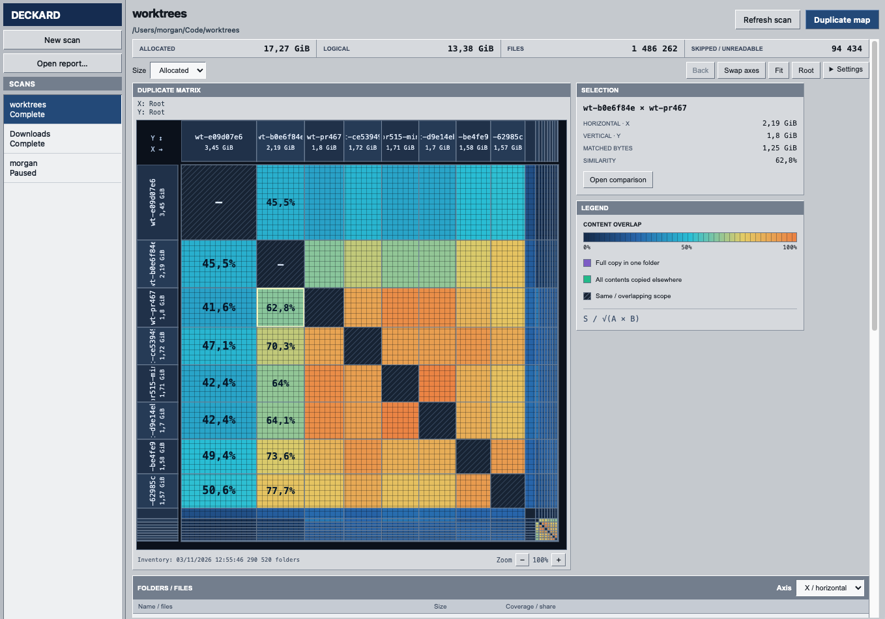

# Deckard

Find duplicate files on your computer or a remote server to see where extra
copies are taking up space.



Native PySide6 controls manage scans; the embedded overlap
map shows byte-weighted relationships between folders and files.

## Run

Requires Python 3.10+ on macOS or Linux, and an OpenSSH client for remote scans.

```sh
python3 -m venv .venv
.venv/bin/python -m pip install -e '.[dev]'
.venv/bin/python -m deckard
```

On macOS, `Deckard.app` is also a double-clickable launcher for the project’s
virtual environment. Build it with `.venv/bin/python tools/macos_launcher.py`.
Building the macOS launcher requires Apple's Command Line Tools (`xcrun clang`).

Choose **Local folder** or **SSH folder**, then start a scan. For SSH, enter a
hostname or an alias from `~/.ssh/config`. Leaving username, port and identity
blank uses normal SSH configuration and current-user defaults. Keys and the
SSH agent are tried first. If needed, Deckard opens a native password,
passphrase or host-confirmation dialog. Passwords are not saved in scan files,
logs, command-line arguments or environment variables.

Pause saves committed progress and disconnects SSH workers. Resume continues
the inventory and valid hash caches. A completed scan can be refreshed to
discover changes while retaining unchanged hashes. Closing the window pauses
an active scan before exiting. Reports can also be opened independently through
**Open a report…**, including reports made by the original scanner.

**Remove scan** deletes a scan from the library along with its local indexes,
checkpoints, logs and reports. Running scans stop before cleanup begins.
Removing a scan keeps the original source files.

## Agentless SSH

The remote host needs an **already installed Python 3 or Python 2.7 interpreter**
and a POSIX shell. Deckard sends its worker source over encrypted SSH stdin and
compiles it into in-memory modules. No scanner installation, uploads, remote
database, temporary script, report, cache or log is created. Python runs with
`-B -S -E`; bytecode writes and site startup hooks are disabled. Worker processes
exit on disconnect. The app does not change remote SSH keys or permissions.

One authenticated OpenSSH master is shared by the scan's persistent workers, so
a password login is not repeated for every worker or batch. Control sockets and
askpass IPC are temporary **local** files. Agent/X11 forwarding and configured
port forwards are disabled for scanner connections. Host verification uses
OpenSSH's normal policy; changed host keys are never silently accepted.

All indexes, diagnostics and report artifacts stay in:

- macOS: `~/Library/Application Support/Deckard/scans/`
- Linux: `$XDG_DATA_HOME/deckard/scans/` (default `~/.local/share/deckard/scans/`)

`DECKARD_DATA_DIR` can override the client data directory. When a local source
contains Deckard's state directory, that state is excluded and recorded as a
coverage blocker. It never scans its own growing index recursively.

## The map

Each axis shows folder/file sizes, using allocated bytes by default, with a
logical-size toggle. Matched mass is summed per content group as
`min(bytes in A, bytes in B)`. Color intensity is
`matched_bytes / sqrt(size_A * size_B)`, matching the original geometric formula.
Scroll or use +/- to zoom, drag to pan, click a band to navigate one axis, and
click a cell to explore both axes. Small items remain accessible through
expandable remainder bands and the item list.
Hold **Shift** to pause hover while moving to the right panel. Release it outside
the map to interact with the current details; hover resumes when you move over
the map without Shift.
Shift+click a cell or axis band to freeze its selection, then move to the right
panel to use **Open comparison** or read its details. **Space** over the map or
**Freeze selection** also freezes the current selection; **Escape** or
**Resume hover** restores hover updates. Opening a new view clears the freeze.
For local scans in the desktop app, **Open in explorer** in the Selection panel
opens both selected folders in the system file explorer. File selections open
their containing folders; a shared folder opens once.

The desktop and report viewer use compact industrial panels and a dark matrix.
**Settings → Theme** offers **Light**, **Dark**, and **System** (the default).
The choice is saved and applies to the native app and embedded report together;
System follows appearance changes automatically. Standalone browser reports
have the same theme selector in Settings and remember the choice for that origin.
Text colors meet WCAG AA contrast (at least 4.5:1), including matrix labels,
which adapt to their heat-map background.
**Settings → Block grid** toggles a fixed-pixel overlay, enabled by default;
file and folder sizes determine the matrix geometry. Existing report data opens
with the app's current viewer;
archived HTML/CSS/JavaScript files remain untouched.

Teal marks folders whose file contents all occur outside that folder, possibly
spread across locations. Purple identifies complete coverage by one disjoint
counterpart. **Find keeper** distinguishes single-location coverage from
coverage spread across multiple locations. Empty files, hardlinks, unreadable
entries and skipped items are included in the coverage checks. Ancestor and
self-matches do not prove duplication.

This is a read-only discovery tool. Coverage compares regular-file contents,
not names, layout, ACLs, xattrs or resource forks. Symlinks and other filesystems
are skipped and block complete-folder claims. Allocated sizes are per path and
exclude directory metadata; hardlinks and storage sharing affect physical space
recovered. Retain a complete copy before removing candidates. A live scan is not
a filesystem snapshot; re-check before deleting modified data.

## Architecture

- `deckard/gui.py`: Qt UI, private SSH prompt dialogs, child process lifecycle.
- `deckard/scan_job.py`: isolated scanning, cancellation, checkpoints, diagnostics.
- `deckard/engine.py`: bounded inventory and size → prefix → conditional sample
  → full SHA-256 pipeline, with the existing 16-file batches and two-worker default.
- `deckard/ssh.py`, `auth.py`, `askpass.py`: native SSH, keys-first login and local
  ephemeral credential IPC.
- `deckard/bootstrap.py`, `remote.py`, `worker.py`, `protocol.py`: streamed,
  read-only in-memory workers and a bounded protocol.
- `deckard/report/`: deterministic Python report generation and JSON query model,
  plus the embedded, offline browser UI. Its SQLite snapshot is independent of
  the live scan and needs no connection to the source to explore.

For a future frontend, call `deckard.report.model.build(index, output)` and
`Report(database).view(...)`, `.covered(...)`, `.keepers(...)` directly. No Qt
dependency is needed to use the engine, agentless protocol or report data model.

The client supports one active scan per window and an exclusive lock per scan
index. Scanning runs outside the GUI process. SQL grouping, local large-file
reads and SSH calls can be interrupted; committed checkpoints remain usable.

## Development

```sh
.venv/bin/python -m pytest -q
```

The regression suite covers detection, fingerprints, hardlinks, raw filenames,
report math, coverage, artifact determinism, HTTP routing and diagnostics.
Desktop-specific tests cover streamed workers leaving no files, interruption
and resume, source-state exclusion, askpass IPC and GUI scan/report integration.
GUI tests use Qt's offscreen platform and an in-memory WebEngine cache.

Every scan records sampled filesystem, hash, SQL, queue and SSH timings locally,
with remote CPU and I/O counters streamed back by the worker. Use **File →
Performance diagnostics** on a selected scan, or run:

```sh
.venv/bin/python -m deckard.diagnostics --state-dir /path/to/scan --seconds 60
```

OpenSSH authentication behavior follows the [OpenSSH manual](https://man.openbsd.org/ssh.1).
The embedded view uses [Qt WebEngine](https://doc.qt.io/qtforpython-6/PySide6/QtWebEngineWidgets/QWebEngineView.html).

MIT licensed. Reports and scan data contain private filenames and should not be
committed; the repository ignores generated databases, logs and environments.
